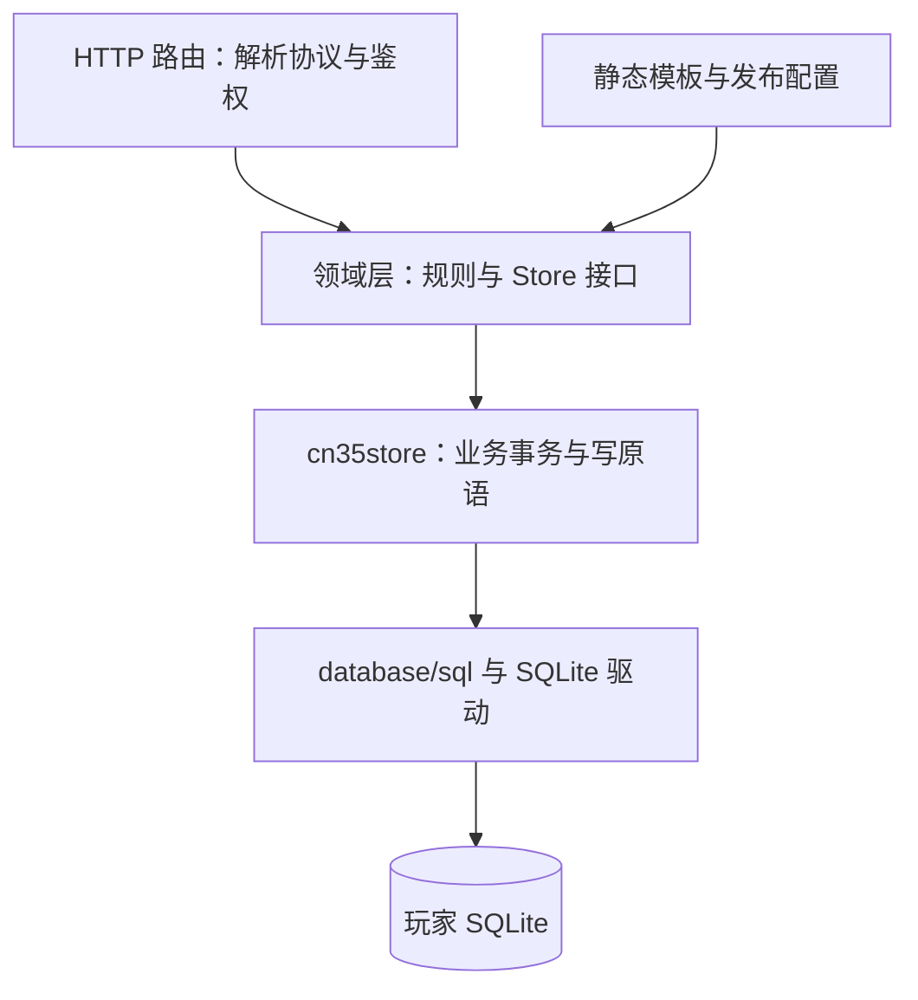

# 数据库与事务教程

服务端把账号、会话、货币、库存、进度和业务操作存入 `<state>/mercd35.sqlite3`。SQLite 通过 Go 驱动嵌入服务进程，不需要独立数据库服务。静态配置和模板供业务读取，玩家状态由数据库持久化；启动时不能用共享 fixture 覆盖已有账号。

## 从请求到数据库



路由负责把输入解释成业务请求，不负责临时建表。领域层判断规则与模板有效性；存储层把需要一起生效的写入组合到同一个 `*sql.Tx`。接口边界应同时说明鉴权、读写范围、失败回执和重试规则。

## 连接与并发

| 配置 | 用途 | 实际边界 |
|---|---|---|
| WAL | 记录提交与恢复，支持读写并发场景 | 应用单连接池仍会限制本进程并发 |
| busy_timeout 5000 ms | 等待外部连接的锁 | 超时仍需返回失败 |
| foreign_keys ON | 启用外键 | 同账号复合外键必须真正存在 |
| synchronous FULL | 提高提交落盘可靠性 | 不等于任意硬件故障下绝不丢失 |
| BEGIN IMMEDIATE | 写事务开始即争取写锁 | 事务必须短 |
| MaxOpenConns(1) | 串行使用连接 | 长查询和长事务都会占用资源 |

这套模型面向单实例本地服务。事务内不等待网络、不调用外部服务，也尽量不扫描静态卡表目录。外部备份或另一个进程仍可能与服务争锁；单连接不能消除所有锁失败。

## 迁移与历史完整性

迁移 SQL 按编号嵌入二进制，由迁移器检查顺序、名称和 SHA-256。`schema_migrations` 保存已应用文件的摘要和执行时间。已应用或已合并的文件不能修改、删除或重排；结构变化追加新迁移。

早期记录的 31 份迁移是当时快照，不能作为固定数量。历史序列不可改写；历史表的存在不代表旧版本业务重新启用。CN3.5 玩家数据只从 `cn35_*` 当前域读取。

迁移由统一事务包装。SQL 文件不自行包 BEGIN/COMMIT，也不嵌入 VACUUM 或修改连接 PRAGMA。扩展列或替换结构采用“扩展→回填→切换读写→后续清理”，配套旧库升级测试。只验证空库能建表，不足以证明升级安全。

## 账号、模板与实例

`cn35_accounts.user_id` 是玩家归属的锚点。账号会话、profile 和余额关联到它。游客设备绑定使用有条件的唯一索引；设备空值不应挤占其他账号名额，注册账号和游客设备复用规则分开处理。

同伴按 `(user_id, unit_id)` 保存，重复副本进入觉醒相关计数；魔宠按 `(user_id, uuid)` 保存实例。模板 ID 表示静态种类，实例 UUID 表示某个账号实际持有的一份。

装备和编队通过 `(user_id, …)` 复合外键与业务校验保证同账号归属。若只校验模板存在，却不校验持有关系，跨账号伪造引用仍可能成功。余额使用非负整数；Size 使用精确十进制；JSON 用于结果快照或版本化扩展，不把全部玩家状态塞进一个共享 JSON。

## 事务边界与复用原语

`withTx` 一类包装负责开始事务、调用业务逻辑、失败回滚和成功提交。公开 Store 方法划定业务边界；内部带 Tx 后缀的写原语接收同一个事务，供抽卡、礼物和奖励路径复用。

```text
开始事务
  检查归属与前置状态
  检查重放或操作冲突
  条件扣费／条件迁移
  发奖、推进状态
  写幂等记录、结果快照和流水
提交；任一步失败则回滚
```

提交成功之后才能向调用方宣称完成。内存临时模型不能在回滚后继续当作已提交状态。

## 建号的原子性

创建账号时，账号行、profile、初始余额、剧情种子和新手礼物需要共同提交。初始单位与余额属于本项目配置，不能按样例推出原服默认资源。任一步失败都不能留下半初始化账号。

游客重入要恢复同一设备关联的合法账号；注册登录和绑定则需校验相应凭据。实际 token、会话密钥与设备值不写进公开样例或审计文本。

## 抽卡：扣费、结果、保底与流水

一次抽卡事务读取或建立保底，条件扣费，结算每抽结果，保存操作和逐抽记录，再写补偿、流水和保底。余额扣费使用带前置条件的更新：余额足够且账号、货币一致时才扣减，并检查影响行数。不能先读余额、在另一个事务里直接扣款。

首次获得同伴插入库存；重复副本复用结算原语，满觉溢出按重建规则补偿。玩家当前余额与审计流水同时提交；流水不是单独的状态源。

操作键、规范化请求摘要和结果快照解决“已识别为同一操作”的重放：同键同参返回原结果，同键异参拒绝。它们无法从缺少稳定请求标识的客户端请求中凭空识别意图。无键抽卡另有有界重放策略，见[业务端点](10-业务端点与持久化.md)。

## 战斗：会话状态与奖励

开战要在同一事务读取本账号实际编队、校验库存、结算 AP、条件扣点并建立战斗会话。客户端提交的全库存 unit_ids 不能代替服务端编队。

会话状态区分 open、prepared、settled 和 abandoned 等阶段。结算校验账号与 battle_id，做条件状态迁移，再写奖励、通关计数、进度、经验和日志。已结算请求应重放或明确返回已领取，不能二次发奖。失败和续战也要受状态机约束。

资源副本的奖励快照绑定配置版本；战斗进行时发布配置，不能改变已经建立的这场奖励。公会战拥有独立时窗和得分规则，不能只替换剧情结算 URL 就宣称实现了整个域。

## AP 惰性恢复

数据库保存 AP 与时间锚点，读取快照或扣点时按完整 300 秒周期追补，上限取 max_ap。扣点的恢复、余额检查和战斗写入在同一事务中完成；剩余周期和到达上限后的重锚属于本项目策略。

普通 Snapshot 可以先做短事务恢复，再分别读取其他域。因此 AP 与 anchor 的单行读取一致，不意味着整个响应是跨所有表的原子快照。将它描述为“完整事务快照”会夸大保证。

## 礼物领取与条件更新

领取同时检查 UUID、账号归属、未领取和有效期。`received_at=0` 条件更新成功后，才在同一事务发奖。事务回滚时，标记和奖励一起回滚；第二次执行影响行数为零，不能再次发奖。

全领可在事务外准备候选与静态校验，但事务内仍需重新执行领取前置条件。过期和不支持类型不能标已领后丢失。unit、monster、货币和物品奖励复用对应原语，避免各入口使用不同的重复副本语义。

## 四类防重的区别

| 机制 | 防什么 | 不保证什么 |
|---|---|---|
| 账号锁或 singleflight | 同时在途的重复计算与并发碰撞 | 进程重启后的永久去重 |
| 唯一台账 | 同一稳定来源或操作键重复发放 | 无法推断两个无键请求是否同一意图 |
| 条件更新 | 余额不足、状态陈旧、已领取等不合法迁移 | 不替代完整业务事务 |
| 结果快照 | 已确认操作的结果重放 | 不把后续合法再次购买永远吞掉 |

## 开发验证与升级恢复

新增写面前先确认字段来源、玩家状态和重试语义，再追加迁移与实现。必要验证包括：空库、真实上一版本结构、代表性旧记录回填、重启、两个账号隔离、重复请求、约束失败回滚与关键并发。

上线前对一致性备份副本演练 status、迁移、完整性检查和核心业务。备份使用 SQLite 一致性机制，不能只复制仍在运行的主 sqlite 文件而遗漏 WAL。恢复使用新的 state 目录与匹配旧二进制，保留问题库；备份之后的写入需要核对。

`mercdb status/check/backup` 面向已存在的库，不应因检查自动初始化或迁移。make 目标与 CLI 参数以随包代码为准；开发通常从 server 模块执行格式检查、vet、单测，必要时执行 race 和目标平台构建。二进制运行不需要 Java、Android 或数据库服务；第一次获取 Go 依赖仍需要网络或预备缓存。
