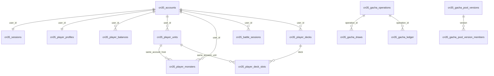

# 数据库结构与数据边界

下列是本项目 SQLite 数据模型，不是原游戏服务器数据库的复刻声明。精确列、索引和约束以 `server/internal/database/migrations/` 为准，业务事务以 `server/internal/cn35store/` 为准。仓库保留历史迁移及游戏运行需要的发布快照结构。

## 表族与关键关系

| 域 | 表族 | 关键边界 |
|---|---|---|
| 账号 | `cn35_accounts`、`cn35_sessions` | user_id 唯一，会话绑定账号；不公开凭据值 |
| 核心资料 | `cn35_player_profiles`、`cn35_player_balances` | profile 按账号；余额按账号×币种 |
| 同伴 | `cn35_player_units` | 账号×模板；等级、觉醒、保护和装备状态 |
| 魔宠 | `cn35_player_monsters` | 账号×实例 UUID；宿主复合外键；Size 可空 |
| 发放 | `cn35_inventory_grants`、`cn35_item_grants` | 来源键与持有写入共同提交 |
| 剧情 | `cn35_quest_progress`、`cn35_quest_clears` | 账号进度；账号×关卡×难度通关计数 |
| 战斗 | `cn35_battle_sessions`、`cn35_battle_logs`、`cn35_player_flags` | battle_id 的账号归属与状态迁移 |
| 编队 | `cn35_player_decks`、`cn35_player_deck_slots` | display_order 和 party_id；固定槽位；库存归属 |
| 抽卡经济 | `cn35_gacha_operations`、`cn35_gacha_draws`、`cn35_gacha_ledger`、`cn35_gacha_pity` | 操作快照、逐抽记录、流水和保底同事务 |
| 名册 | `cn35_unit_templates`、`cn35_unit_template_revisions`、`cn35_unit_assets`、`cn35_unit_roster`、`cn35_roster_sources` | 模板修订、资源证据、导入来源与启用状态分离 |
| 抽卡发布 | `cn35_gacha_pools`、`cn35_gacha_pool_draft_members`、`cn35_gacha_pool_versions`、`cn35_gacha_pool_version_members`、`cn35_gacha_release` | 草稿不直接参与抽取；生效指针指向不可变快照 |
| 页面和内容 | `cn35_messages`、`cn35_app_conf_versions`、`cn35_infos`、`cn35_user_presents` | 内容池、配置版本、礼物领取状态 |
| 物品 | `cn35_item_catalog`、`cn35_player_items` | 静态目录与账号数量分开 |
| 资源副本草稿 | `cn35_resource_quest_drafts`、`cn35_resource_quest_drops`、`cn35_resource_quest_waves`、`cn35_resource_quest_rune_drops` | 波次、概率和掉落待发布后生效 |
| 资源与交易所发布 | `cn35_medal_goods_drafts`、`cn35_resource_config_versions`、`cn35_resource_config_release` | 商品和副本配置的版本快照 |
| 资源奖励 | `cn35_resource_reward_events`、`cn35_medal_purchase_totals`、`cn35_medal_grants` | 奖励来源幂等、累计限购、发放台账 |
| 教程与技能 | `cn35_tutorial_task_claims`、`cn35_player_skills` | 教程领取去重，账号技能持久化 |
| 公会 | `cn35_guilds` 与 members/subscriptions/ops/defense/equipment/invest_log 表族 | 归属、审批、设施、防卫与操作记录 |
| 公会战 | `cn35_gw_*` 表族 | 场次、参与、动作、得分、攻击和结算快照 |
| 每日商店 | `cn35_daily_shop_claims` | 每日领取幂等 |
| 审计 | `cn35_admin_audit` | 历史治理写入的记录载体；存在此表不代表后台公开 |

表族缩写仅为阅读索引，不代替完整 DDL。历史迁移可能包含退役域或当前未提供业务的表；CN3.5 不借这些旧表初始化玩家状态。

## 核心关系图

关系图用来表达归属方向，不代替每张表在迁移中的实际可空性或删除规则。

## 重要演进点

0003/0004 建立独立 CN3.5 账号域和游客设备索引；0005 建库存与发放台账；0006/0007 建进度与战斗；0008 建账号编队；0009 增加魔宠 Size。0012/0013 承载抽卡经济与名册发布；0016 增加 helper；0017 形成物品和资源副本发布；0022 回填用户经验需求；0027–0029 承载公会及公会战；0030 增加符文掉落；0031 承载每日商店。

AP 惰性恢复复用已有列，没有因“增加恢复逻辑”就创建新表。0022 用临时映射完成 max_exp 回填，也不新增永久经验表。迁移号是演进证据，不是用功能数量衡量游戏完成度的指标。

## AP、编队与 Size

AP anchor 在库中保存 UTC 时间，wire 输出整数秒。快照先追补、后读取；完整响应不承诺跨域一致事务快照。扣点要与战斗建立或状态更新一起提交。

编队 parties 必须按 display_order 输出有序对象，槽位保留空字符串。初始两队五槽和填充顺序是本项目策略。读取首次默认编队可能产生写入，所以“读端点”不必然等于数据库只读。

Size 的四列是 scale、real_scale、scale_limit 与 is_rare。NULL 表示未证／降级，不能以零伪装缺失。未迁移旧库的只读预览可退回旧列集；发放等写入必须检查必要迁移已应用，不能隐式升级目标库。

## 发布配置与运行快照

抽卡和资源副本运行读面使用 release 指向的不可变快照。草稿变更、来源导入与启用管理位是不同动作。资源齐备不等于可抽取；启用池空名单、成员阻断、稀有度或限时字段冲突要在发布前拒绝。

发布治理表保留，是为了运行时能解析既有生效快照与维持升级历史。这些表属于运行数据层，没有对应的公开管理界面。

## 与静态数据的分工

cardcatalog 为模板真源；玩家等级、觉醒、库存数量和装备在库中。当前面板按模板与玩家状态派生，不需把每次计算结果都存成列。用户 rank 经验与同伴经验是两套规则。

奖励领取、抽卡、徽章兑换和战斗结算的余额／库存变化与幂等记录必须同事务。运行库、WAL、备份和实际审计行属于本地运行数据，不在仓库中。
