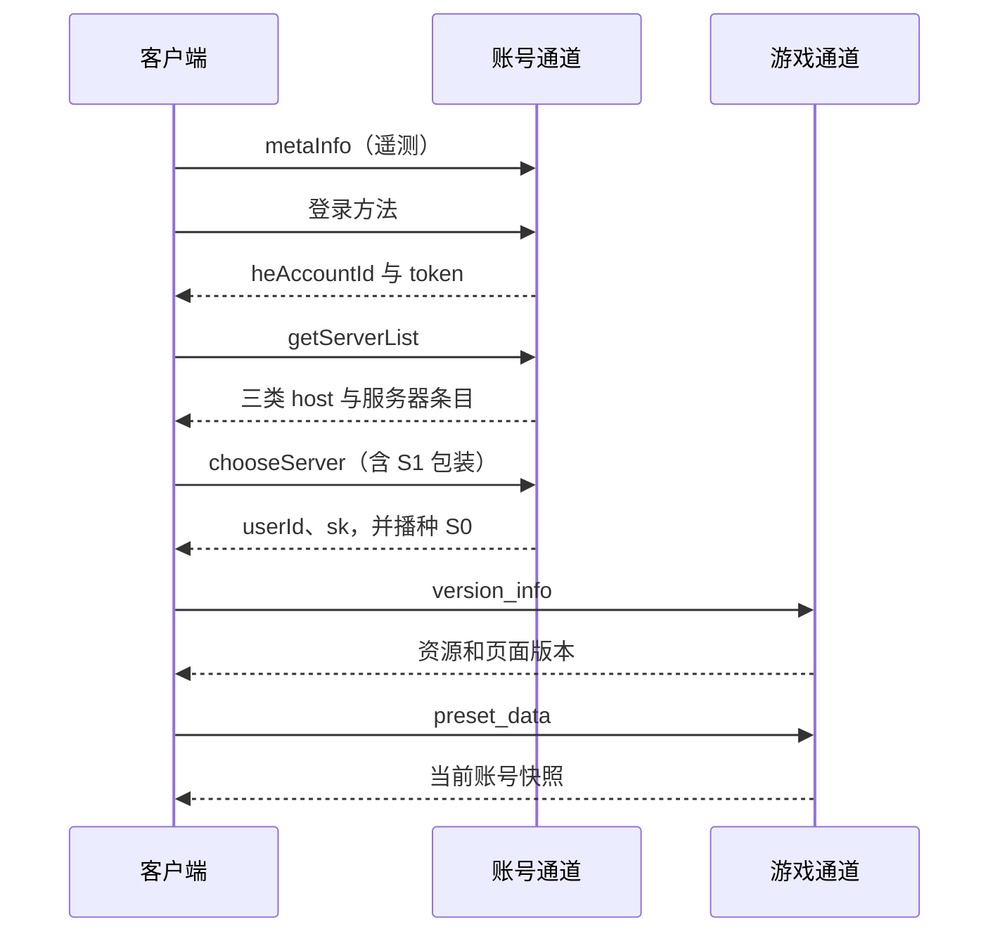

# 传输、登录与启动契约

CN3.5 把账号信封、游戏文档和静态资源分成不同通道。身份字段名可以用于理解契约，但本文不携带实际账号、设备数据、口令、SDK 参数秘密或密钥常量。精确编解码以 `server/internal/cn35protocol/` 为准。

## 通道与格式

| 通道 | 入口 | 请求形态 | 响应形态 |
|---|---|---|---|
| verify | `POST /account?uid=666666` | 账号信封，经 type3 编码 | type300 编码，含 header/results/events |
| game | 业务路径 | 加密 query `e` 与 type4 表单体 | 扁平 JSON；ENCRYPTED:true 时按 type301 解码 |
| 静态配置 | `.json.encode` | 无 body，可有版本 query | 明文或可解压文本 |
| bundle | `/toto_image_4/unity/...unity3d` | 普通下载 | 二进制资源 |

账号编码涉及 AES、压缩、帧与 XOR 的组合，响应还带是否播种 S0 的 marker。游戏通道使用 S0/S1 派生的会话密钥；type4 明文为表单与 stp 时间后缀，type301 为会话解密后解压。账号响应必须是合法编码帧，不能因为游戏响应允许明文就给 verify 也返回裸 JSON。

游戏 query 的 Base64 可能含 `+`、`/`、`=`，从 RawQuery 提取 e 后再解码。先按普通 URL 表单把加号转为空格，会破坏密文。解码后剥离时间后缀，再按表单规则解析业务参数。

## HTTP 方法与身份头

客户端的逻辑 GET 也可能通过 HTTP POST 携带 `_method=GET`。读面需按实际传输注册 GET/POST，不能只看到调用名 GetFromServer 就假定外层方法一定是 GET。

| 字段 | 协议作用 | 文档边界 |
|---|---|---|
| APP_ID_1 | 解出 user_id，用于查会话 | 不提供真实值 |
| APP_ID_2 | 身份一致性校验材料 | 不作为玩家状态源 |
| APP_ID_3 | 可选设备推送令牌 | 不公开设备令牌 |
| APP_ID_4 | 解出游戏 sk，进行会话鉴权 | 不公开实际密钥 |
| APP_T | 会话时间校验材料 | 不等同稳定业务幂等键 |
| Encrypted | 请求加密提示 | 不决定账号信封能否明文返回 |
| DEVICE_INFO、IID、VID、PID 等 | 设备和统计元信息 | 只说明键名，省略实际设备样例 |

设备遥测不是重建核心玩法的状态源。公开日志与审计不得记录明文口令、token、sk 或其他会话材料。

## 账号信封

账号请求将公共元信息和 method 业务对象分组。公共字段包括版本 v、meta 版本 mv、设备类型 ct、应用标识 aid、语言 lang、平台 pf、计数 st 和可选 uk；其中应用级 sk 与选服后的用户 sk 是不同概念。

成功响应 header.errCode 为 0，results 的业务项 retCode 为 200，method 与业务字段同层。以下仅是没有个人信息的独立示意：

```json
{
  "header": {"errCode": 0},
  "results": [{"method": "metaInfo", "retCode": 200}],
  "events": []
}
```

events.firstActive 用于客户端统计，不代替服务端账号创建。header.uk 是可选的后续回带字段。

## 登录与选服链



metaInfo 接受编码后的设备信息，未知遥测键应容忍，回调失败不作为主登录业务的阻断。启动实际分支与更新流程可能影响它是否触发，不能把它列成所有场景的强制前置。

| 登录方法 | 主要字段 | 成功消费 |
|---|---|---|
| ucLogin | accountId、randomStr、accessToken、loginExtend、deviceId | success、逐字回显 randomStr、heAccountId、token、msg |
| heQuickLogin | randomStr、deviceId | 同上；游客重入关联已有合法账号 |
| heLogin | userName、pwd、deviceId | success、heAccountId、token、msg |
| heRegister | accountName、pwd、deviceId、pf、可选 bindEmail | success、heAccountId、token、msg |
| heRegCheck | accountName | ok |

SDK 路径的字段兼容不等于已经验证官方 SDK 后端令牌。游客和 HE 账号路径可独立验证。

getServerList 接收 token、heAccountId、deviceId、pf、clientVersion 等，返回服务器列表与可选 lastLoginServer。每条必须包含 serverIP、serverId、serverName、serverStatus、assetInfoServerIp、staticHostIp；三个 host 分别用于游戏、配置和 bundle，不填真实部署地址作为公开示例。维护状态完整枚举和风控字段仍需按具体分支核对。

chooseServer 校验账号凭据与所选服，处理含 r/m/data 的特殊包装。r 是当前会话 S1，m 是完整性材料；实现应按已有宽容解包规则处理，不能简单假定包装总是标准 JSON。成功返回 userId、sk，并最晚在此时播种 S0，随后持久化会话；缺少播种会使首个游戏请求失败。

## 绑定与继承

heAccountBind 统一处理游客转正和账号继承。先看 accountName 是否已有：已有则校验目标账号口令并继承；不存在则验证当前游客凭据后更新原行，保留 user_id 和进度并轮换 token。错误响应带 success:false 和 msg，不能省略成功标记让客户端陷入异常。

邮件找回、解绑和特定渠道检查不是本文确认的最小链路。不能仅因为方法名存在就宣称完整实现。

## 版本与页面配置

version_info 返回非零 asset_info_version 与 app_conf_version，并与实际下发材料一致。零值会使客户端继续等待。静态清单及 app_conf 的版本更新驱动缓存失效；页面实例是否重建另见[生命周期](02-UI挂载与页面生命周期.md)。

app_conf 提供 pages、partials、requireData 和页面选项，由服务端装配下发。资源清单描述逻辑名、版本和下载标记；bundle 为实际二进制，索引存在不代表文件齐全。

## 玩家快照与教程

preset_data 响应含 preset_data_version 和 data。data.user 至少承担 id、昵称、level、exp/max_exp、AP/BP、队长、货币、教程与进度；具体键还受当前模块装配影响。user_units、user_monsters、user_decks 与对应账号库存同源。

| 键 | 关键语义 |
|---|---|
| user.game_status | 2 表示教程完成；教程中不提前下发该值 |
| user.user_name | 当前昵称；不要用共享样例覆盖 |
| consts.task_v2 | 教程分流，会改变剧情和抽卡演出必经材料 |
| consts.time | 整数服务器时钟 |
| consts.load_quest1 | 教程资源预载选择 |
| temp_gacha_result | 完整演出分支的临时结果；精确字段需按对应消费链核对 |
| tutorial_session.value | 教程奖励上下文，不能凭键名补造完整结构 |
| user_coin、user_summary | 账号余额与汇总 |
| language_patch、act_pages | 静态文案／活动配置或显式空态 |

`/users/verify_nickname` 接收 user_name，返回 result。`/users/update` 用 user_name 保存昵称，用 tutorial_finish=true 标记完成；完成响应 status 必须为 success，之后的快照稳定反映 game_status=2。命名、教程写入与双账号隔离要在持久化层确认，不能仅靠客户端 PlayerPrefs。

## 通用游戏响应副作用

ResponseFilter 将 data 的各键写入缓存，data_query 做局部字段合并，还处理 modal、notifications 和 auth_invalid。即使某个业务 Document 的 ParseCore 没有显式分支，通用过滤层也可能消费同一个顶层键。

因此“某解析器没列出”不足以证明“整客户端丢弃该字段”。定位问题时分别检查通用副作用、业务子文档解析和实际行为消费。
